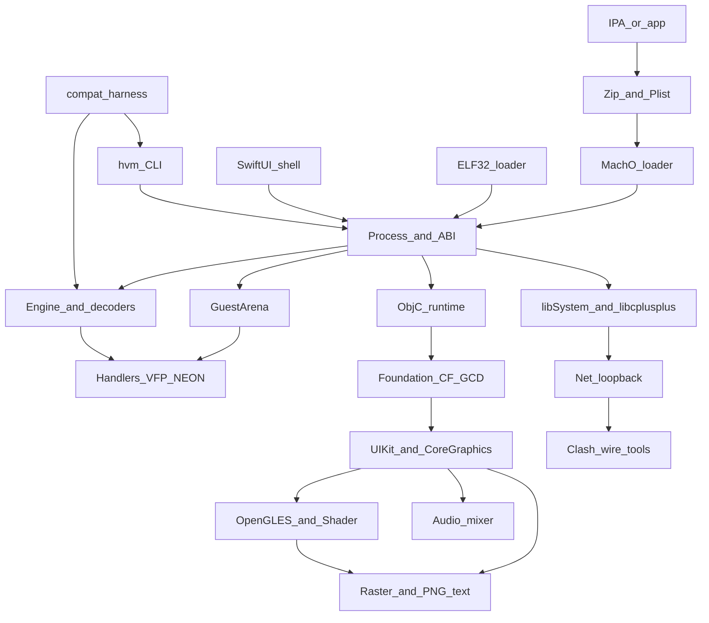

# Architecture map

HydrogenVM is a JIT-less ARMv7 user-mode emulator. Guest code is decoded lazily into `Op` records and executed by ahead-of-time C++ handlers that tail-call. No guest code is written into executable host memory. One process owns a 4 GB `GuestArena`, an `Engine`, guest threads that are host threads, and a symbol table that binds Mach-O imports to host functions. Frameworks are a guest Objective-C runtime in C++. The UI is composited in software. The phone shell is SwiftUI under `app/`. The desktop CLI is `tests/runner/HvmCli.cpp` and `HvmRun.cpp`.

This map is the ownership contract for the seven roles below. It is not a behavior change.

## Dependency graph

`HVMEngine.mm` is the only Swift-to-C++ bridge. Shell work uses `app/HydrogenVM/Bridge/HVMEngine.h` as the frozen surface. A runtime change that alters that header is Group E as well as the runtime role, and it waits for a Mac.

## Roles

Only these roles. Loaders, libc++, and the test harness are sub-areas, not extra roles.

### Runtime / CPU and memory

Guest execution and the address space.

| Owns | Notes |
|---|---|
| `src/core/cpu/` | Decoders, `Handlers.hpp`, `FpHandlers.hpp`, `NeonHandlers.hpp`, `Engine.cpp`, `BlockBuilder.hpp`, `Cpu.hpp` |
| `src/core/memory/` | `GuestArena.*` |
| `src/runtime/libc/System.cpp` | Only the mapping and protection entries (`mprotect`, `madvise`, `msync`, `vm_protect`) are Group A. Other libc files are guest frameworks |
| `src/selftest/` | Built-in burst used by `hvm_tests selftest` and the phone app |
| `tests/asm/arm_mem.S` | Group A memory tests |

Group A is this role's exclusive set: arena, load/store handlers, the fault path, `mprotect`, `arm_mem.S`. One owner. CPU fusion does not start until that set is quiet.

Faults today: `Engine::run` reports the block start as the PC, and the signal handler `siglongjmp`s across the handler. That is safe only for a tail call with no live C++ objects. HLE that touches an unmapped guest pointer through `mem.host()` takes the same path.

Fast loads and stores do not consult `protAt`. On a 4 KB host, an unmapped guest page usually faults because the host page was never committed. On a 16 KB iOS host, a live mapping commits neighboring 4 KB guest pages. Linux tests do not catch that. Reports must record `host.pageSize` and must not call a 4 KB pass an iPhone memory-model pass.

### Guest frameworks

Objective-C, Foundation, UIKit classes, and the libc symbols those apps actually call. Not OpenGL.

| Owns | Notes |
|---|---|
| `src/runtime/objc/` | Classes, dispatch, blocks, ARC, placeholders |
| `src/runtime/foundation/` | Collections, strings, runloop, dispatch, CFNetwork, keychain |
| `src/runtime/uikit/` except `OpenGLES.cpp` | Views, widgets, nibs, CoreGraphics, QuartzCore, GameKit, gestures |
| `src/runtime/libc/` except the Group A lines in `System.cpp` and except `Net.cpp` while Group C is active | Strings, stdio, math, pthreads, Mach ports, libstdc++, the thin `std::__1` slice |
| `src/runtime/Heap.*`, `src/runtime/Abi.hpp` | Marshalling. A signature change that `HVMEngine.h` reflects is also Group E |

Group D is the object model: `objc/`, `foundation/`, `UIWidgets.cpp`, `Nib.cpp`, `UIView.cpp`, and the other UIKit class files. One owner at a time. `CGFont*` work is Group D.

libc++ and libstdc++ file streams are the same role but a private sub-area: one editor for `LibStdcxx.cpp`, `LibStdcxxContainers.cpp`, `LibStdcxxStreams.cpp`, `Cxx.cpp`, `Unwind.*`. That editor is not also rewriting Foundation in the same lap.

`regcomp` and `tmpnam` are this role and are not Group D when the patch stays in `src/runtime/libc/`.

Placeholder classes are created for missing framework classes and logged. The harness records that as a signal, not as a crash.

### Graphics, audio, and input

Pixels, samples, and the events that feed them.

| Owns | Notes |
|---|---|
| `src/runtime/uikit/OpenGLES.cpp` | GLES 1.1 and the straight-line GLES 2 rasterizer. Group B |
| `src/runtime/graphics/Shader.cpp`, `Shader.hpp` | Group B. Unsupported syntax fails compilation |
| `src/runtime/graphics/Raster.cpp`, `Png.cpp`, `Pvrtc.cpp`, `Text.cpp`, `TrueType.cpp` | Raster joins Group B when a compositing change shares varyings or the framebuffer with GLES |
| `src/runtime/audio/` | WAV, CAF IMA4, AIFF, MP3, mixer. May run beside Group B |
| Audio entry points in `src/runtime/uikit/PlatformStubs.cpp` | Coordinate. Do not edit this file while another role has it open |
| `src/runtime/uikit/Gestures.cpp` and the CLI input path in `tests/runner/HvmRun.cpp` | Touch injection. The CLI flag surface is shared with the harness; behavior changes belong here, flag additions that the harness needs are test/regression and must not change guest timing |

Group B is shaders, `OpenGLES.cpp`, and the GLES section of `TestRunner.cpp`. One owner. Order is fixed: a homogeneous near-plane clip (today line 2320 only replaces a near-zero W, and lines 2449–2452 rasterize the bbox of already-projected vertices), then a checked-in shader corpus, then SIMD and threads. `glPointSizePointerOES` is this role and waits if the clipper owns the file.

The CLI pumps the mixer only when `--audio-fd` is a datagram socket. The harness opens that socket so the report has levels. Silence with `frames > 0` means the mixer ran and the guest produced zeros, not that the socket was missing. There is no speaker on a headless run.

### App compatibility, including the Clash protocol

How a guest image becomes a process, and the Clash peer that speaks to one pinned client.

| Owns | Notes |
|---|---|
| `src/loader/` | Mach-O, IPA/zip, plists, ELF32 for tests. Not group C. One loader editor at a time |
| `tools/clash_wire.py`, `clash_home_state.py`, `clash_protocol_probe.py`, `clash_home_probe.py`, `clash_royale_probe.py` | Group C |
| `tools/test_clash_protocol_probe.py`, `tools/test_clash_home_state.py`, `tools/test_ima_wav_corpus.py` | Group C for the protocol tests. The IMA corpus needs the unpacked client |
| `src/runtime/libc/Net.cpp`, `Network.hpp` | Group C while the peer is being developed. Loopback IPv4 TCP only, and only when the flag is set |

Group C is one owner. A GLES shader dumped from Clash is Group B, scheduled with the raster owner, not patched inside the protocol tools.

The pinned client hash is `29269ede437f39ffa62fb4234a1c323303ef417e7eb6ddc5c86f9be76e08fb3f`. The manifest lists it as optional. The harness does not download it. FairPlay-encrypted images are classified and not executed.

`tools/compat.py` remains the interactive multi-app scanner (strict run, keep-going run, `REPORT.md`). The harness is the versioned CI gate. They are different tools. `clash_royale_probe.py` imports `macho_info` from `tools/compat.py`, which is why the harness package is `tools/compat_harness/` and not `tools/compat/`.

### Test, regression, and the harness

| Owns | Notes |
|---|---|
| `tools/compat_harness/`, `tools/hvm_compat.py` | This gate |
| `tools/run_tests.sh`, `tools/build_tests.sh` | The C++ case list the harness copies. A test that changes the list updates both |
| `tests/asm/`, `tests/c/`, `tests/runner/` except a behavior change inside the engine | Adding a case is this role. Changing an opcode's result is the runtime role plus this role's new expected values |
| `tools/tests/test_verify_ipa.py`, `tools/verify_ipa.py` | Packaging checks. Synthetic zips, not the commercial IPAs |
| `.github/workflows/compat-harness.yml` | Read-only permissions. Does not push `ci-reports` |
| `.github/workflows/ci.yml`, `tools/hvm_report.py`, `tools/publish_report.sh` | Existing publisher. One editor at a time. Not modified by the harness patch |

The harness records. It does not weaken a failing `fulltest` to produce a baseline.

### Review, integration, and docs

No runtime ownership. This role reads every diff and writes:

| Owns | Notes |
|---|---|
| `docs/dev-system/` | Plan, roadmap, backlog, this map, harness guide, status, baselines |
| Review notes on a PR | Does not push fixes onto the author's branch |

The reviewer re-runs the harness or reads the attached JSON, checks group boundaries, and refuses a 4 KB report that claims to prove the iPhone memory model. Branch protection that requires this review is Needs owner. Nothing in the repository requires a second reader today.

### Apple shell

| Owns | Notes |
|---|---|
| `app/HydrogenVM/**` | SwiftUI library, run screen, diagnostics, file browser |
| `app/project.yml`, entitlements | iPhone only, arm64, iOS 26, Swift 6, extended virtual addressing |
| `app/HydrogenVM/Bridge/HVMEngine.mm` and `HVMEngine.h` | The bridge. Header changes ship with the Swift that calls them |

Group E. Linux cannot compile this role. `tools/sim_test.sh` is the simulator check and runs on the macOS job only.

## Hosts

| Host | What it can prove |
|---|---|
| Linux, 4 KB pages, no display | Engine build, CPU differential tests, `fulltest`, software framebuffer smokes, mixer levels over a socket |
| Linux plus `tools/build_cctools.sh` | iOS stub-SDK guests and CoreMark. Not part of the harness job |
| macOS with Xcode | `app/` device and simulator builds. The macOS job is skipped unless the commit message contains `[mac]`, the run is manual, or it is the Monday schedule. Linux CI started again on `6af9976` (run 39646696896); the empty-step failure on `07fabbb` (run 39633887764) was real and is not the current Linux state |
| iPhone, 16 KB pages | The memory-model hole, entitlements, device audio, Metal is not the GLES path (GLES is software) |

## Deliberate non-goals already in the code

- No FairPlay decryption.
- `CCCrypt` ciphers unimplemented; digests and HMAC implemented.
- Privileged ARM and `SETEND` ignored or rejected.
- No general outbound network. Loopback only, and only by flag.
- No JIT and no writable-executable guest code.
