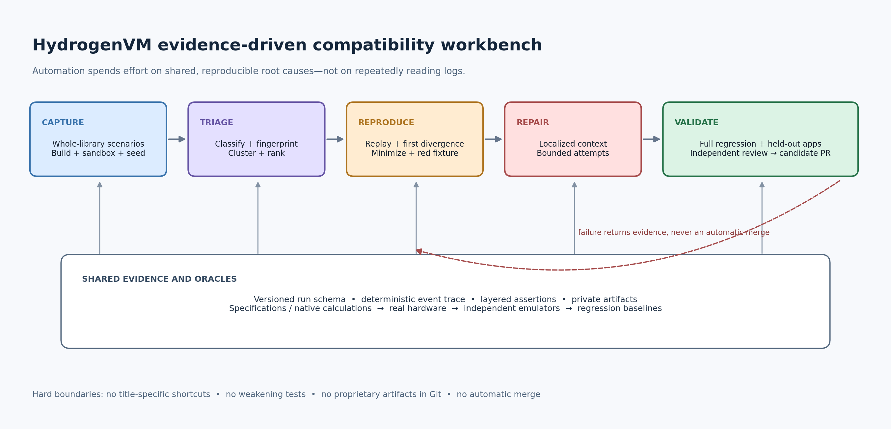

# HydrogenVM automated compatibility and bounded-repair workbench

**Research and design report — 2026-10-26.** This is an implementation blueprint, not a claim that the proposed system has already been built or that any game has passed it. It complements [`COMPARABLE_PROJECTS.md`](COMPARABLE_PROJECTS.md), which covers emulator architecture and performance.

## Executive recommendation

Build **one evidence pipeline around the existing `hvm_probe.py`, Test Lab, compatibility harness, and iPhone Test All Games runner**, not another scanner and not an autonomous “fix every IPA” bot. The pipeline should run the whole private library, classify failures, group likely shared causes, reproduce the best candidate with a clean sandbox and recorded inputs, minimize that reproduction, and turn the underlying behavior into a synthetic red-first Test Lab case. A repair agent may then propose a small, general runtime change within an explicit budget. It earns only **candidate** status after the complete regression gates, affected real-game scenarios, positive controls, and held-out games pass; an independent reviewer and Lawson still decide integration. This is more scalable than assigning 20% of a session to each title because expensive diagnosis is spent on shared, reproducible root causes instead of repeated log reading.

The highest-value missing capability is not more random tapping. It is a **shared, versioned evidence contract plus stronger oracles**: what executed, which inputs and initial state were used, which assertion failed, where two implementations first diverged, and whether the result repeats. Existing infrastructure already supplies deterministic headless scripts, missing-function extraction, parallel execution, baseline diffs, seeded device exploration, two-finger gestures, lifecycle checks, relaunch, and useful counters. [hvm_probe](kimi-cite://md-line?path=C%3A%2FUsers%2FLawson_PC%2FDesktop%2Ftest_ipa%2FHydrogenVM-main%2Ftools%2Fhvm_probe.py&line=97&text=A%20deterministic%20interaction%20script "citation"), [BatchExplore](kimi-cite://md-line?path=C%3A%2FUsers%2FLawson_PC%2FDesktop%2Ftest_ipa%2FHydrogenVM-main%2Fapp%2FHydrogenVM%2FBatchExplore.swift&line=150&text=func%20run(deadline "citation") The proposal extends those foundations rather than discarding them. It deliberately excludes FairPlay work, cipher implementations, proprietary fixtures in Git, title-specific shortcuts, false-success stubs, and automatic merging. Lawfully owned commercial IPAs authorize the owner’s private testing workflow; they do **not** authorize redistribution of IPAs, game captures, save data, or derived copyrighted trace assets.



## 1. What HydrogenVM already has—and what is not yet proven

The repository has a stronger starting point than a typical per-game debugging loop. The desktop probe imports each IPA once, generates a bundle-ID-seeded script, optionally runs software and HostGL modes, captures reports/logs/screenshots, normalizes messages, groups issues, ranks them by severity and affected runs, and diffs a baseline. [hvm_probe](kimi-cite://md-line?path=C%3A%2FUsers%2FLawson_PC%2FDesktop%2Ftest_ipa%2FHydrogenVM-main%2Ftools%2Fhvm_probe.py&line=266&text=groups%20%3D%20%7B%7D "citation") On iPhone, Test All Games uses a throwaway home, resumes incomplete batches, explores with a stable seed, exercises single- and two-finger input and lifecycle transitions, and performs a second launch against saved state. [BatchTest](kimi-cite://md-line?path=C%3A%2FUsers%2FLawson_PC%2FDesktop%2Ftest_ipa%2FHydrogenVM-main%2Fapp%2FHydrogenVM%2FBatchTest.swift&line=471&text=Each%20run%20gets%20a%20throwaway%20copy "citation") Test Lab already requires independent expectations and a red-first minimal guest for every real-app bug class; those are exactly the right long-term regression assets. [TEST_LAB](kimi-cite://md-line?path=C%3A%2FUsers%2FLawson_PC%2FDesktop%2Ftest_ipa%2FHydrogenVM-main%2Fdocs%2FTEST_LAB.md&line=363&text=Reproduce "citation")

The present checks are nevertheless **discovery signals, not proof of correct gameplay**. A frame counter and a non-black final screenshot can miss a loading screen, animation starvation, or incorrect orientation; a screen change after a tap does not establish that the intended control received the right touch. The device checklist treats any rendered mixer frames as “Audio output” and positive music/effect voice counters as “heard,” while physical speaker behavior remains a separate manual Test Lab check. [BatchChecks](kimi-cite://md-line?path=C%3A%2FUsers%2FLawson_PC%2FDesktop%2Ftest_ipa%2FHydrogenVM-main%2Fapp%2FHydrogenVM%2FBatchChecks.swift&line=124&text=Audio%20output "citation"), [TEST_LAB](kimi-cite://md-line?path=C%3A%2FUsers%2FLawson_PC%2FDesktop%2Ftest_ipa%2FHydrogenVM-main%2Fdocs%2FTEST_LAB.md&line=142&text=Speaker%20playback "citation") Exploration uses wall-clock deadlines and only saves the last 20 actions after a crash, which is useful context but not a complete minimized replay. [BatchExplore](kimi-cite://md-line?path=C%3A%2FUsers%2FLawson_PC%2FDesktop%2Ftest_ipa%2FHydrogenVM-main%2Fapp%2FHydrogenVM%2FBatchExplore.swift&line=326&text=reproSteps "citation") The immediate work is therefore to preserve these useful signals while adding provenance, richer behavioral assertions, clean replay, and explicit confidence levels.

| Capability | Present foundation | Missing or weak guarantee | Workbench decision |
|---|---|---|---|
| Whole-library runs | Parallel `hvm_probe`; resumable iPhone batch | Device and desktop reports are not one schema | Versioned common run record with platform-specific extensions |
| Reproduction | Seeded taps/drags, saved scripts, scratch homes | Guest clocks, RNG, scheduling, and all inputs are not captured | Deterministic scenario manifest and event stream |
| Triage | Message normalization, severity, affected-run count | Generic text clusters can merge distinct stacks or split one cause | Typed failure plus versioned structural fingerprint |
| Exploration | Grid taps, swipes, long press, two-finger tap, pinch, tilt | Fixed sequence is not state-guided and has no persistent milestones | Screen-state graph plus reusable scenario checkpoints |
| Graphics | Final-frame signal, offscreen-present counter, HostGL comparison | No command-stream minimization or per-draw localization | GL/EAGL trace replay and first-divergence report |
| Audio | Mixer activity, voice classes, peak, decode failures | Activity is not audible correctness; no input-route oracle | PCM measurements, reference comparisons, manual route tests |
| Repair discipline | Red-first Test Lab, full gates, real-app checks, review rule | No bounded repair runner or held-out evaluation | Candidate-only automated loop; no auto-merge |
| Scale/security | Local private fixtures and CI gates | Retention, trust boundaries, and sharding policy need definition | Private isolated shards, compact public summaries only |

## 2. What to reuse from other projects

No external project supplies a drop-in JIT-less iPhone core or a universal correctness oracle. touchHLE is architecturally relevant because it is a high-level emulator for early iOS applications, but its own documentation says most early apps do not currently work and that compatibility is app-driven; its source is MPL-2.0 while distributed binaries and some bundled components have different terms. [touchHLE](kimi-cite://web?url=https%3A%2F%2Fgithub.com%2FtouchHLE%2FtouchHLE&text=The%20vast%20majority%20of%20iOS%202.x%2C%203.x%20and%204.x%20apps%20do%20not%20currently%20work%20in%20touchHLE "citation"), [touchHLE licensing](kimi-cite://web?url=https%3A%2F%2Fgithub.com%2FtouchHLE%2FtouchHLE&text=The%20source%20code%20of%20touchHLE%20itself%20(not%20its%20dependencies)%20is%20licensed%20under%20the%20Mozilla%20Public%20License%2C%20version%202.0. "citation") HyperHLE is useful as an independent compatibility data point, not as ground truth; its repository describes a separate AI-assisted touchHLE fork and explicitly disclaims upstream endorsement. [HyperHLE](kimi-cite://web?url=https%3A%2F%2Fgithub.com%2FHyperHLE%2FHyperHLE&text=This%20fork%20utilizes%20AI%20tools%20and%20assistance "citation") **Reuse workflows and ideas first. Check the exact file/dependency license and settle HydrogenVM’s missing root-license policy before copying any implementation.**

The mature pattern across emulator and fuzzing infrastructure is to make failures replayable, comparable, small, and cheap to retest. QEMU records nondeterministic events and instruction counts so replay can inject inputs at matching execution points. [QEMU](kimi-cite://web?url=https%3A%2F%2Fwww.qemu.org%2Fdocs%2Fmaster%2Fdevel%2Freplay.html&text=Execution%20recording%20writes%20a%20non-deterministic%20events%20log "citation") Dolphin records and replays CPU-to-GPU data, comparing rendering across emulator revisions and real hardware. [Dolphin](kimi-cite://web?url=https%3A%2F%2Fdolphin-emu.org%2Fblog%2F2015%2F01%2F25%2Fmaking-developers-more-productive-dolphin-development-infrastructure%2F&text=for%20each%20new%20version%20of%20Dolphin%2C%20it%20compares%20the%20rendering%20of%20a%20set%20of%20recorded%20GPU%20commands "citation") ClusterFuzz combines deduplication, minimization, regression bisection, and crash statistics rather than treating a crash dump as the end of automation. [ClusterFuzz](kimi-cite://web?url=https%3A%2F%2Fgoogle.github.io%2Fclusterfuzz%2F&text=Testcase%20minimization. "citation") These are the reusable architectural lessons; HydrogenVM still needs its own iOS behavior specifications and device checks.

| Project or research | Useful mechanism | HydrogenVM application | Limit / reuse boundary |
|---|---|---|---|
| touchHLE / HyperHLE | Independent early-iOS HLE behavior and compatibility evidence | Differential API traces and second opinions | Agreement is supportive evidence, never proof; audit licenses per component |
| PPSSPP | Debugger that steps through graphics draws | Draw-level replay and inspection | Different platform/API; do not import architecture wholesale. [PPSSPP](kimi-cite://web?url=https%3A%2F%2Fgithub.com%2Fhrydgard%2Fppsspp&text=Allows%20for%20very%20rapid%20development%20of%20new%20features%20and%20has%20a%20very%20nice%20Ge%20debugger%20for%20stepping%20through%20draws. "citation") |
| QEMU record/replay | Event log, instruction counts, clock and input capture | Guest-visible event journal keyed to deterministic execution progress | A full deterministic multithreaded replay is staged work, not a flag flip |
| Dolphin FifoCI | Recorded graphics streams compared across revisions and hardware | Private GL/EAGL traces plus synthetic, redistributable equivalents | Commercial captures remain private; image differences need interpretation |
| apitrace | GL call tracing, replay, state inspection at a call | Trace schema and draw/state inspection model | Use ideas or MIT-licensed code only after dependency review. [apitrace](kimi-cite://web?url=https%3A%2F%2Fgithub.com%2Fapitrace%2Fapitrace&text=inspect%20OpenGL%20and%20Direct3D%20state%20at%20any%20call%20while%20retracing "citation") |
| Socorro | Normalized stack-based crash signatures and reprocessing | Versioned fingerprints with split/merge review | Over- and under-grouping are unavoidable and must be correctable. [Socorro](kimi-cite://web?url=https%3A%2F%2Fsocorro.readthedocs.io%2Fen%2Flatest%2Fsignaturegeneration.html&text=When%20it%20generates%20too%20coarse%20a%20signature "citation") |
| ClusterFuzz / libFuzzer | Coverage-guided corpus, minimization, dedup, bisection | Structured HLE/input fuzzers and crash pipeline | Whole-game fuzzing is slower and less deterministic than narrow targets. [libFuzzer](kimi-cite://web?url=https%3A%2F%2Fllvm.org%2Fdocs%2FLibFuzzer.html&text=Usually%2C%20the%20narrower%20the%20target%20the%20better. "citation") |
| Delta debugging | Minimize inputs while preserving an interestingness predicate | Reduce actions, GL calls, sandbox deltas, and schedules | Requires a stable predicate; unresolved runs are not passes. [Zeller and Hildebrandt](kimi-cite://web?url=https%3A%2F%2Fwww.cs.purdue.edu%2Fhomes%2Fxyzhang%2Ffall07%2FPapers%2Fdelta-debugging.pdf&text=The%20Delta%20Debugging%20algorithm%20generalizes%20and%20simplifies%20some%20failing%20test%20case%20to%20a%20minimal%20test%20case "citation") |
| rr | Deterministic host replay, reverse debugging, chaos mode | Optional Linux host-side diagnosis of captured failures | rr records supported Linux host executions; it does not replay an iPhone or validate guest iOS semantics. [rr](kimi-cite://web?url=https%3A%2F%2Frr-project.org%2F&text=You%20record%20a%20failure%20once%2C%20then%20debug%20the%20recording%2C%20deterministically "citation") |
| AutoCodeRover / patch-overfitting research | Iterative context retrieval, bounded patch validation, correctness caution | Ranked evidence packet and localized repair agent | Published results are not HydrogenVM results; plausible patches can be wrong. [AutoCodeRover](kimi-cite://web?url=https%3A%2F%2Farxiv.org%2Fhtml%2F2404.05427v3&text=Our%20code%20search%20exploits%20the%20program%20structure "citation"), [patch assessment](kimi-cite://web?url=https%3A%2F%2Farxiv.org%2Fhtml%2F1909.13694v3&text=a%20generated%20patch%20passing%20all%20test%20cases%20may%20still%20be%20incorrect "citation") |

## 3. The shared evidence contract

Create a versioned `hvm-evidence/v1` run manifest consumed by both desktop and iPhone runners. It should identify the exact emulator commit and dirty state, build configuration, host OS/device/page size, renderer, app version and private SHA-256, scenario version, initial sandbox identity, exploration seed, clock policy, timeout policy, and all feature flags. Every attempt gets its own record; retries never overwrite earlier outcomes. Store compact run indexes and separate rich artifacts by hash so identical logs/traces are deduplicated. Public issue drafts may include bundle ID, version, function names, normalized stacks, and redacted logs, but proprietary images, audio, input captures, save contents, and full traces remain private. This contract is the integration point that prevents the desktop probe, phone report, replay minimizer, and repair runner from becoming four incompatible tools.

Each observation must carry **scope and strength**, not just pass/warn/fail. `process_alive`, `frame_presented`, `mixer_active`, `pcm_nonzero`, `scenario_milestone`, `reference_match`, and `manual_device_verified` answer different questions and must not collapse into “works.” Record `not_run`, `not_applicable`, `inconclusive`, and `infrastructure_error` separately from a behavioral failure. A host teardown timeout, missing fixture, runner crash, or lost trace is not evidence that the game failed. Existing owner reports correctly insist that a startup smoke or a different app version cannot resolve an interaction/world-load scenario; the schema should preserve that rule mechanically. [USER_APP_REPORTS](kimi-cite://md-line?path=C%3A%2FUsers%2FLawson_PC%2FDesktop%2Ftest_ipa%2FHydrogenVM-main%2Fdocs%2Fdev-system%2FUSER_APP_REPORTS.md&line=29&text=Read%20this%20file%20together "citation")

```json
{
  "schema": "hvm-evidence/v1",
  "attempt": 2,
  "build": {"commit": "<sha>", "dirty": false, "configuration": "Release"},
  "host": {"kind": "linux|iphone", "os": "<version>", "pageSize": 4096},
  "app": {"bundleId": "<id>", "version": "<version>", "sha256": "<private-manifest-id>"},
  "scenario": {"id": "world-load", "version": 3, "seed": 42,
               "sandbox": "<initial-state-hash>", "clock": "recorded"},
  "outcome": {"class": "behavioral_failure", "milestone": "world-enter"},
  "observations": [{"kind": "api_divergence", "strength": "derived_oracle",
                    "artifact": "<private-hash>"}],
  "fingerprint": {"version": 2, "id": "<hash>"},
  "artifacts": {"manifest": "<hash>", "events": "<hash>", "traceLoss": 0}
}
```

A failure fingerprint should combine **typed outcome + normalized failing operation + meaningful stack prefix + renderer/build semantics**, excluding addresses, wall-clock timestamps, and volatile counts. Keep separate cluster keys for guest crash, host crash, guest-handled fault, missing API, assertion, timeout/liveness, incorrect output, and performance regression. Do not rank raw log volume. A useful initial queue score is `severity × affected-distinct-apps × reproducibility × scenario-criticality ÷ estimated-repair-cost`, with each factor and confidence visible. Missing APIs get a second ranking based on static reachability, actual calls, first-divergence proximity, number of distinct blocked apps, and whether an honest implementation exists; an imported-but-never-called symbol is not equivalent to a function on the crashing path.

## 4. Deterministic replay, divergence, and minimization

Use **event-sourced scenario replay before attempting whole-machine snapshots**. A scenario bundle contains an immutable initial sandbox, ordered touch/keyboard/text/microphone/sensor/lifecycle/network events, RNG seeds, renderer configuration, and a guest-clock policy. Record every external value visible to the guest, including time queries, random bytes, host callbacks, audio input, and asynchronous completion ordering. During replay, inject those values at recorded guest-progress markers rather than at wall-clock timestamps. QEMU’s replay design is the model: external input, hardware clocks, interrupts, and instruction counts are explicit replay concerns. [QEMU](kimi-cite://web?url=https%3A%2F%2Fwww.qemu.org%2Fdocs%2Fmaster%2Fdevel%2Freplay.html&text=replaying%20all%20non-deterministic%20events%20including%20external%20input%2C%20hardware%20clocks%2C%20and%20interrupts "citation") Production timing must remain honest; deterministic time is a test mode, not a way to make slow emulation appear correct.

The comparison tool should emit the **first meaningful divergence**, not a giant final-state diff. Canonicalize HLE/API events with sequence number, guest thread, normalized caller, selector/function, arguments, return/status, and relevant state hashes; then compare HydrogenVM against a prior known-good build, software versus HostGL, or an independent implementation. The earliest difference is a hypothesis to investigate, because either implementation—or the expectation—may be wrong. For host-only Linux races, rr can capture a failing host process for deterministic reverse debugging and can perturb scheduling with chaos mode, but it cannot supply missing device evidence. [rr](kimi-cite://web?url=https%3A%2F%2Frr-project.org%2F&text=rr%20also%20provides%20efficient%20reverse%20execution%20under%20gdb "citation") Flaky scenarios retain every attempt and report rates by identical build/sandbox/seed; a retry that passes is **flaky**, never a clean pass. This follows the flaky-test literature’s distinction between inconsistent outcomes and reliable bug signals. [Parry et al.](kimi-cite://web?url=https%3A%2F%2Fdl.acm.org%2Fdoi%2FfullHtml%2F10.1145%2F3476105&text=a%20test%20that%20can%20be%20observed%20to%20both%20pass%20and%20fail%20without%20changes%20to%20the%20code%20under%20test "citation")

Only minimize after the failure predicate repeats under controlled conditions. Delta-debug complete action sequences first, then individual event payloads, GL frames/calls, initial sandbox differences, or recorded thread interleavings while preserving the same fingerprint and milestone. Delta debugging is specifically designed to simplify a failing case while preserving the failure and to isolate passing/failing differences. [Zeller and Hildebrandt](kimi-cite://web?url=https%3A%2F%2Fwww.cs.purdue.edu%2Fhomes%2Fxyzhang%2Ffall07%2FPapers%2Fdelta-debugging.pdf&text=it%20also%20isolates%20the%20difference%20between%20a%20passing%20and%20a%20failing%20test%20case "citation") The final commercial reproduction remains private; manually translate the behavior into a minimal synthetic `TL-X` guest whose expected result comes from documentation, native execution, or hand calculation. Prove that fixture fails on the pre-fix build and passes afterward. A smaller trace that changes the failure, loses its initial state, or only passes because the timeout was enlarged is not a valid reduction.

## 5. Layered oracles and subsystem recipes

The oracle survey distinguishes specified, derived, implicit, and absent-oracle approaches; no single automated judgment covers every program behavior. [Barr et al.](kimi-cite://web?url=https%3A%2F%2Feecs481.org%2Freadings%2Ftestoracles.pdf&text=These%20four%20categories%20comprise%20approaches%20to%20the%20oracle%20problem%3A%20specified%2C%20derived%2C%20implicit%2C%20and%20no%20test%20oracle "citation") HydrogenVM should therefore rank evidence from **independent specification/native calculation**, then **real legacy-iOS behavior**, then **independent emulator or renderer**, then **previous HydrogenVM output**. A regression baseline protects behavior already believed good but cannot establish correctness. Two emulators agreeing can mean they share the same misunderstanding; two disagreeing identifies an investigation point. Metamorphic checks add relations when an exact expected frame is unavailable—for example, permuting independent touch IDs must not swap their tracked positions, and rotating coordinates twice in opposite directions should restore the original within a documented transform.

Assertions should form layers from cheap universal invariants to narrow scenario-specific proof. This avoids both “exit code zero means compatible” and an impractical demand for pixel-perfect equality on every host GPU. Keep tolerances versioned and justified; never regenerate goldens automatically from the patch under review. Known-good commercial captures can be private regression evidence, while committed synthetic fixtures use independent expectations as Test Lab already requires. [TEST_LAB](kimi-cite://md-line?path=C%3A%2FUsers%2FLawson_PC%2FDesktop%2Ftest_ipa%2FHydrogenVM-main%2Fdocs%2FTEST_LAB.md&line=338&text=Every%20expected%20value%20must%20be%20derived "citation")

| Layer | Examples | What it proves | What it does not prove |
|---|---|---|---|
| L0 runner integrity | Fixture hash, process isolation, complete artifact manifest | Result belongs to the intended run | App behaved correctly |
| L1 implicit faults | No guest/host crash, sanitizer finding, deadlock, missing assertion | A specific failure did not occur | Correct picture, audio, or gameplay |
| L2 API/state invariants | Touch identity stable, GL object ownership valid, audio callback deadlines sane | Defined runtime semantics hold | App’s intended user-visible result |
| L3 scenario milestones | Menu → character → world; record → stop → playback | Required path was reached | Entire game is compatible |
| L4 measured output | Reference image/PCM comparison, frame sequence timing, saved-state assertions | Specific output matches within a stated rule | Unmeasured modalities or later scenes |
| L5 real-device/manual | Speaker and microphone route, physical orientation, sustained interaction | Device-specific behavior is confirmed | Other devices, versions, or scenarios |

| Subsystem | Automated scenario and strong evidence | Diagnostic/minimization path |
|---|---|---|
| Graphics and animation | Capture ordered frame samples and presentation timestamps; assert expected scene/motion, not merely non-black. Replay GL/EAGL streams through software and HostGL; compare selected draws and state. | First differing call/state → remove later frames and irrelevant calls → synthetic draw fixture. Dolphin/apitrace-style replay applies here. |
| Multitouch | Scripted overlapping hold/move/end/cancel with multiple fingers; assert finger identity, coordinates, timestamps, and simultaneous application response. | Reduce event sequence while preserving identity mismatch or dropped movement. Apple documents that a `UITouch` persists through a multi-touch sequence. [Apple UITouch](kimi-cite://web?url=https%3A%2F%2Fdeveloper.apple.com%2Fdocumentation%2Fuikit%2Fuitouch&text=A%20touch%20object%20persists%20throughout%20a%20multi-touch%20sequence. "citation") |
| Keyboard and text | Focus field, present keyboard, insert Unicode/emoji, delete, selection, return/dismiss, hardware-key path where applicable; assert stored text and responder callbacks. | Reduce to responder/focus transitions and text-operation expectations; do not infer success from a keyboard image alone. |
| Orientation and sensors | Replay gravity/orientation sequences for portrait/landscape/flips; assert legacy and modern coordinate transforms and UI placement separately. | Compare coordinate tuples at each layer; validate physical holding posture manually on device. |
| Audio output | Callback/mixer liveness → PCM peak/RMS, clipping, silence spans, onset/loop timing, channels and spectrum → known-tone/reference comparison → speaker check. | Minimize callback schedule and PCM segment; distinguish decode, mixing, queueing, and host delivery. ViSQOL is a reference-based spectrogram comparison, not universal correctness. [ViSQOL](kimi-cite://web?url=https%3A%2F%2Flink.springer.com%2Farticle%2F10.1186%2Fs13636-015-0054-9&text=examining%20similarity%20in%20time-frequency%20representations%20of%20the%20reference%20and%20degraded%20speech "citation") |
| Microphone / talking apps | Inject synthetic recorded PCM with exact timing; assert requested format/route, input callback delivery, recorded duration/data, processing, and playback. | Split capture, encoding, animation, and playback milestones; physical mic privacy/route behavior remains manual. |
| Lifecycle and persistence | Fresh install and populated-home runs; background/resume, close, relaunch, repeated relaunch; assert saved file semantics and active callbacks. | Preserve the same sandbox through the whole sequence; minimize file deltas and lifecycle events, never clear state to make the failure disappear. |
| Threads and timing | Deterministic event order for conformance; repeated controlled schedules/load for robustness; host ASan/TSan jobs where supported. | Record first ordering divergence; replay failing schedule; distinguish host defects from guest timing assumptions. |

## 6. Guided exploration and fuzzing

Replace the fixed explore-only policy with a **budgeted hybrid explorer**. Seed the existing grid and gestures, then represent each stable observation as a node in a screen-state graph using a robust perceptual hash plus view/GL/audio/API features. Edges are replayable input sequences, not just coordinate taps. Prefer actions likely to reach unseen states, retain milestone paths such as “menu dismissed” or “world loaded,” and allow curated scripts to start from those checkpoints. Stateful exploration research builds a runtime state-transition model because stateless random events do not adapt to the current application state. [DroidBot study](kimi-cite://web?url=https%3A%2F%2Flink.springer.com%2Farticle%2F10.1186%2Fs13635-019-0087-1&text=a%20state%20transition%20model%20generated%20on-the-fly%20from%20the%20information%20monitored%20at%20run-time "citation") Random exploration still has value for discovery and robustness, but “20 taps executed” is not a coverage metric.

Use narrow coverage-guided fuzzers where inputs are structured and execution can reset cheaply: Mach-O/import metadata, plist and archive handling, texture/shader translators, audio format setup, touch-event streams, and GL command streams. libFuzzer tracks coverage to mutate a corpus and supports corpus and crash minimization, but its documentation also stresses determinism, narrow targets, and clean state. [libFuzzer](kimi-cite://web?url=https%3A%2F%2Fllvm.org%2Fdocs%2FLibFuzzer.html&text=It%20must%20be%20as%20deterministic%20as%20possible. "citation") Whole-game exploration should be grammar-based and seeded rather than raw-byte fuzzing. Every finding gets a signature, repeatability status, minimized trace, sanitizer result when applicable, and a synthetic regression candidate. Set time/memory/worker budgets, isolate each process, and never allow fuzz-generated network or filesystem behavior outside the fixture sandbox.

## 7. Bounded repair loop with independent validation

The repair agent receives a **small evidence packet**, not the entire repository and log history: cluster summary and confidence, minimized replay, first divergence, relevant API specification or native result, red-first fixture, implicated functions/files, related passing controls, and ownership boundaries. It retrieves additional code context iteratively and proposes one general behavior change. AutoCodeRover supports the value of iterative program-structure retrieval and test-guided context, but its published benchmark does not demonstrate correctness on HydrogenVM. [AutoCodeRover](kimi-cite://web?url=https%3A%2F%2Farxiv.org%2Fhtml%2F2404.05427v3&text=The%20LLM%20agent%20directs%20the%20navigation%20and%20decides%20which%20code%20search%20APIs%20to%20use "citation") Set explicit limits on attempts, changed files, runtime, tokens, and validation jobs. When the budget is exhausted, return the improved reproduction and unresolved diagnosis; do not widen scope or keep patching until something looks green.

Validation has three separate questions: **does the new test fail before and pass after; does anything else regress; is the behavior actually right?** Run all mandatory gates, the affected real-game scenario in applicable renderer modes, known-good positive controls, the whole private library or a risk-based superset, and held-out apps/scenarios not shown to the patch generator. Test-suite-passing patches can overfit incomplete tests, so independent inputs and review are necessary rather than decorative. [Patch assessment research](kimi-cite://web?url=https%3A%2F%2Farxiv.org%2Fhtml%2F1909.13694v3&text=The%20essential%20reason%20behind%20the%20overfitting%20problem%20is%20that%20the%20test%20cases%20used%20for%20guiding%20patch%20generation%20are%20incomplete. "citation") HydrogenVM already requires an independent reviewer and owner merge; preserve that boundary. [AGENTS](kimi-cite://md-line?path=C%3A%2FUsers%2FLawson_PC%2FDesktop%2Ftest_ipa%2FHydrogenVM-main%2FAGENTS.md&line=97&text=One%20branch%20per%20agent "citation") The automated result vocabulary is `reproduced`, `candidate`, `regressed`, `inconclusive`, and `needs_device`; only a reviewer can mark the change ready for Lawson’s integration decision.

| Gate | Required evidence | Automatic outcome |
|---|---|---|
| Reproduction gate | Same fingerprint repeats; clean initial state; trace loss accounted for | Otherwise `inconclusive`, no repair attempt |
| Fixture gate | Synthetic expectation independent; fails pre-fix; passes post-fix | Missing red proof rejects candidate |
| Correctness gate | API/native/reference rationale; no successful no-op or title check | Wrong or unsupported semantics rejected |
| Regression gate | All current gates, affected app, positive controls, no baseline regression | Any unexplained regression rejects candidate |
| Generalization gate | Held-out apps/scenarios and both renderers where relevant | Failure returns evidence to triage |
| Review gate | Independent reviewer examines diff and attached evidence | Only then eligible for owner review; never auto-merge |

## 8. Observability, artifacts, CI, and security

Add low-overhead structured tracing with per-subsystem bounded ring buffers and explicit dropped-event counters. Trace events need a global sequence plus guest thread/progress marker; wall time is metadata, not the replay key. Preserve a compact always-on journal and enable expensive payloads only for a selected reproduction. Perfetto’s buffer model illustrates why ring-buffer overwrite and packet loss must themselves be observable. [Perfetto](kimi-cite://web?url=https%3A%2F%2Fperfetto.dev%2Fdocs%2Fconcepts%2Fbuffers&text=older%20tracing%20data%20is%20overwritten%20by%20virtue%20of%20wrapping%20in%20the%20ring%20buffer "citation") A divergence report is invalid if the missing event could be inside a trace gap. For graphics, capture referenced guest bytes by content hash and retain object/state summaries so a minimized stream can replay without the original process.

CI should be tiered by cost and evidence strength. Every patch runs synthetic/unit/Test Lab and targeted regression checks; affected real apps and positive controls run in private isolated jobs; scheduled whole-library sweeps shard by app and renderer with deterministic work assignment; physical-iPhone speaker, microphone, orientation, and sustained-use checks remain a later manual or privately provisioned device tier until device CI actually exists. Keep compact pass summaries indefinitely and failed attempt manifests long enough for regression analysis; rich commercial traces, images, audio, and sandboxes use short explicit retention, encryption/access control, hash deduplication, and owner-controlled deletion. Never upload private artifacts to public issues, caches, or third-party model prompts.

Commercial IPAs and uploaded files remain untrusted inputs: one new directory per fixture, isolated Python invocation, resource limits, no secrets, no general outbound network, and no execution with signing credentials present. GitHub specifically warns that self-hosted runners lack ephemeral-clean guarantees and can be persistently compromised by untrusted code. [GitHub Actions security](kimi-cite://web?url=https%3A%2F%2Fdocs.github.com%2Fen%2Factions%2Freference%2Fsecurity%2Fsecure-use&text=Self-hosted%20runners%20for%20GitHub%20do%20not%20have%20guarantees%20around%20running%20in%20ephemeral%20clean%20virtual%20machines "citation") Separate unprivileged fixture runners from build/signing infrastructure, pin and audit dependencies, use least-privilege tokens, and do not share caches across trust levels. Synthetic fixtures and schemas are safe to commit; commercial IPAs, copyrighted captures, private saves, certificates, and secrets are not. HydrogenVM’s rules already prohibit those artifacts and FairPlay/cipher implementations; this design changes neither rule. [AGENTS](kimi-cite://md-line?path=C%3A%2FUsers%2FLawson_PC%2FDesktop%2Ftest_ipa%2FHydrogenVM-main%2FAGENTS.md&line=103&text=Do%20not%20add%20proprietary%20binaries "citation")

## 9. Delivery sequence and acceptance gates

The rollout should produce useful evidence after every stage rather than waiting for a grand “self-healing emulator.” Stages 1–3 offer the best near-term return because they convert existing reports into reliable work items and durable tests. Repair automation comes only after replay and oracles are trustworthy; otherwise the system efficiently produces plausible wrong patches. Device-specific work remains conditional because no physical-device CI availability has been established. Likewise, no throughput or compatibility improvement is claimed below: each stage’s metrics must be measured on the actual library and compared with the current manual workflow.

Do not measure success as “number of games marked fixed.” Track unique reproducible failure clusters, median time from report to clean reproduction, percentage of failures with minimized red fixtures, candidate acceptance/rejection rate, regressions per accepted change, held-out generalization, flaky rate, trace-loss rate, and scenario coverage. These measures reveal whether automation is helping or merely producing more green labels. Keep a fixed evaluation set of historical failures and positive controls outside the repair prompt, and periodically replay old resolved scenarios so new fixes do not silently weaken earlier behavior.

| Stage | Concrete deliverables | Acceptance gate before advancing |
|---|---|---|
| **1. Evidence and triage** | `hvm-evidence/v1`; desktop/phone adapters; typed outcomes; structural fingerprints; missing-API ranking; private artifact index | Same fixtures produce stable IDs; import/crash/hang/behavioral/host failures stay distinct; manual split/merge works; no private artifacts enter Git |
| **2. Replay and minimization** | Clean sandbox bundles; seeded input/clock journal; first-divergence viewer; action/trace reducer | A selected set of historical failures replays cleanly; minimizer preserves fingerprint and milestone; unresolved runs cannot count as passes |
| **3. Strong oracles** | Scenario milestones; layered graphics/touch/text/orientation/audio/lifecycle checks; synthetic TL conversions | Each check has a documented false-positive/negative boundary; new fixtures are red-first with independent expectations |
| **4. Guided discovery** | Screen-state graph, milestone checkpoints, structured fuzz targets, sanitizer jobs, flaky-attempt records | Newly discovered issues include seed, repeatability, minimized input and trace integrity; coverage is compared with the existing explorer |
| **5. Bounded repair** | Evidence packet generator, scoped patch runner, retry budgets, held-out evaluation, candidate report | Historical benchmark compares accepted candidates with known fixes; overfitting/regressions reject automatically; independent review remains mandatory |
| **6. Scale and device validation** | Private sharded scheduled sweeps, retention controls, optional real-device tier | Recovery from worker failure works without contaminating later games; retention/deletion is audited; physical checks report device/build provenance |

**Implementation checkpoint — 2026-10-26:** the initial stage 1 slice now exists in `tools/hvm_evidence.py`, `tools/hvm_fingerprint.py` and `tools/hvm_evidence.schema.json`. Probe sweeps emit shared evidence automatically, the CLI adapts existing desktop/device reports, and synthetic tests cover stable IDs, typed failures, flaky retries, split/merge, missing-API ranking and private artifact indexing. New device reports carry compiled-commit and page-size provenance. This is testing infrastructure only; it does not establish any new game compatibility result. Stage 2 replay/minimization remains unimplemented.

The first implementation slice should be deliberately narrow: **one shared run schema, one fingerprint module, one replayable scenario format, and one report that turns the top cluster into a clean reproduction plan**. Good initial validation cases are simultaneous move/look touch, text-field presentation/storage, four physical orientations, known-tone output plus microphone injection, and a same-sandbox close/relaunch sequence. These cover the reported bug families without title-specific logic and create reusable components for many games. GL capture/replay and automated patch proposals should follow after those fundamentals demonstrate reliable replay and assertions.

## 10. Success-criterion verdict

The table is the direct verdict on the requested “ultimate testing/fixing bench.” **Present** means useful code already exists, not that the entire criterion is complete. **Extension** means the design requires new implementation. **Device-required** marks checks that cannot be certified by desktop automation alone. No criterion justifies a claim of universal IPA compatibility; the practical objective is a continuously improving compatibility engine with auditable evidence and bounded automation.

Two boundaries are especially important. A reliable whole-library sweep can discover and prioritize defects without proving that every game works, because exploration and oracles are incomplete. A bounded repair agent can reduce repetitive engineering only after failures are reproducible and expectations are independent; otherwise it optimizes for misleading checks. This is why the recommendation combines broad automated discovery with deep shared-subsystem fixes, rather than choosing between “all at once” and “one by one.”

| # | Criterion | Design verdict |
|---:|---|---|
| 1 | Grouping and reproduction | **Present + extension:** retain probe clustering; add typed fingerprints, split/merge, clean replay, and reproducibility confidence. |
| 2 | Bounded repair, full regression, independent review | **Extension around present gates:** candidate-only attempts with budgets; existing full gates and independent reviewer remain mandatory. |
| 3 | Systematic exploration/fuzzing with signatures and minimized traces | **Extension:** hybrid explorer plus narrow coverage-guided fuzzers; every finding gets a stable signature and reducer. |
| 4 | Deterministic clocks, RNG, timing, repeatability | **Major extension:** record all guest-visible nondeterminism and replay by guest progress; wall-clock deadlines alone are insufficient. |
| 5 | Least-divergence comparison against alternatives | **Extension:** canonical API/GL event comparison against known-good builds, renderers, hardware, and independent emulators; disagreement is a hypothesis. |
| 6 | Multilayer oracles | **Extension:** specification/native, real hardware, independent implementation, regression baseline, and metamorphic checks with explicit strength. |
| 7 | Clean replay | **Extension:** immutable initial sandbox, complete event journal, feature/build identity, and trace-integrity accounting. |
| 8 | Flakiness | **Extension:** retain all attempts; rerun under controlled scheduling/load; retry success remains flaky and cannot erase failure evidence. |
| 9 | Input coverage | **Present + extension:** existing gestures expand to persistent multi-pointer identity, text/keyboard, sensors, cancellation, and scenario-specific simultaneous input. |
| 10 | Measurable audio | **Present + device-required:** retain counters; add PCM/timing/spectral/reference tests, microphone injection, and physical route/listening checks. |
| 11 | API/function ranking | **Present + extension:** combine static reachability, dynamic calls, divergence proximity, affected distinct apps, severity, and honest repair cost. |
| 12 | Observability | **Extension:** structured low-overhead traces, ring buffers, loss counters, first-divergence reports, and content-addressed payloads. |
| 13 | CI and scaling | **Extension:** cheap public synthetic gates plus private sharded real-app tiers; physical-device CI is conditional, not assumed. |
| 14 | Guided exploration | **Extension:** screen-state graph, unseen-state priorities, milestone checkpoints, curated scripts, and measured coverage. |
| 15 | Artifact retention | **Extension:** content hashes, compact long-term summaries, short explicit rich-artifact retention, redaction, encryption, and deletion controls. |
| 16 | Layered assertions | **Extension:** L0 runner integrity through L5 real-device verification; no single “passed” bit across evidence levels. |
| 17 | Reusable components | **Extension with strong foundation:** shared schema, scenario DSL, event recorder/replayer, fingerprinting, reducers, oracles, and synthetic TL conversion serve all titles. |
| 18 | Legal, IP, and security rules | **Mandatory boundary:** private lawful testing only; no redistribution, FairPlay/ciphers, secrets, shared trust caches, or unreviewed external code copying. |

**Bottom line:** build the evidence and replay layer first, then stronger oracles, and only then bounded automated repair. That order gives Lawson quicker shared fixes without sacrificing correctness, while preserving the existing JIT-less emulator, Test Lab discipline, device builds, and human integration control.
